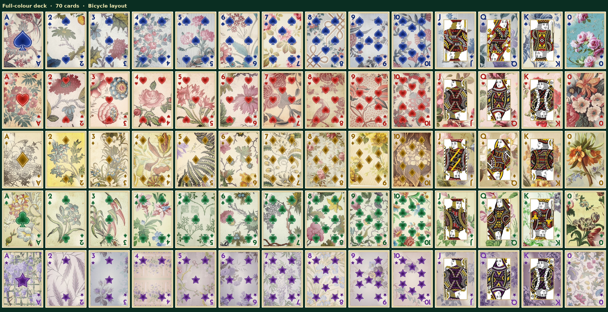
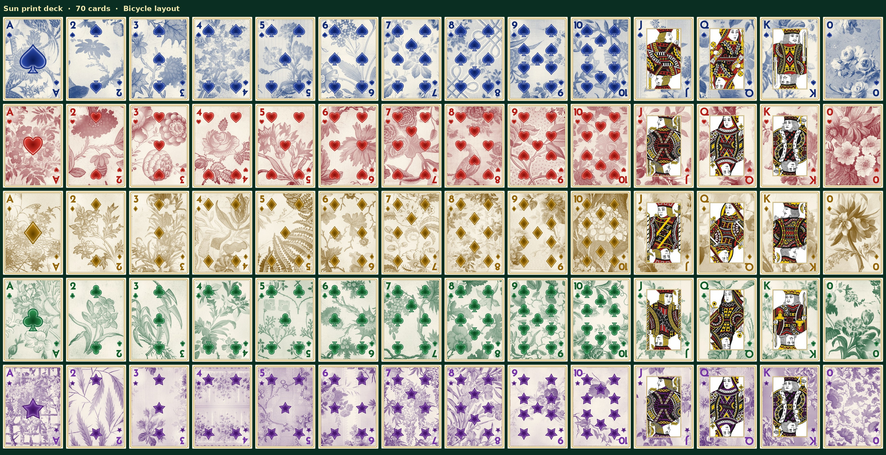

# The Floral Deck

A 70-card playing-card deck dressed in historic floral prints, in two versions: **full colour** and **sun print** (one-ink cyanotype style). Five suits of 14 cards each: A, 2–10, J, Q, K and a **0**.

| Suit | Colour | Sun-print ink |
|---|---|---|
| Spades ♠ | blue | blue |
| Hearts ♥ | red | red |
| Diamonds ♦ | gold | yellow ochre |
| Clubs ♣ | green | green |
| Stars ★ | purple | violet |

Stars is a fifth suit, built for this deck.

**Full colour**

**Sun print**

## License: CC0 1.0 (public domain)

The whole deck is dedicated to the public domain under [CC0 1.0 Universal](LICENSE). That covers the card images, the papers, the overviews, the credits and the manifest. You can copy, change, print, sell and build on it without asking and without credit.

The flower papers come from the Smithsonian's Open Access collection and are CC0 themselves. Credit isn't required, but the sources are listed in [CREDITS.txt](CREDITS.txt) for anyone who wants to find the originals.

## What's here

| Folder | What |
|---|---|
| `deck-full-color/` | 70 cards, 500×700 PNG, named `suit-rank.png` (e.g. `stars-Q.png`, `hearts-0.png`) |
| `deck-sun-print/` | the same 70 cards in sun print |
| `full-color-images/` | the paper clippings behind each card, 1000×1400 JPG |
| `sun-print-images/` | the same clippings as one-ink sun prints, named `clipping-ink.jpg` |
| `CREDITS.txt` | every card's paper: object, date, place and Smithsonian link |
| `manifest.json` | machine-readable: each clipping's source record, image ID, scan size and crop box; which clipping goes on which card; the sun-print inks |

A few clippings in the image folders aren't on any card; CREDITS.txt lists them at the end.

## How the cards are made

- **Papers.** Each card's background is a 5:7 crop from a museum scan of a wallpaper, printed textile, or textile design, mostly 18th- and 19th-century French, English, Indian and American work from Cooper Hewitt, Smithsonian Design Museum. On the card it fades toward the centre and behind the corner indices so the pips read.
- **Sun prints.** Each clipping's tones are stretched, then the darks go to the suit's ink and the lights to cream, with a faint wash and grain.
- **Layout.** Pips follow Bicycle proportions. The court figures sit in a gold-framed panel. The **0** has no pips; its paper is shown whole.
- **Stars.** The stars cards are built from the hearts cards: same layout, each heart replaced by an enamel star, the court figures recoloured purple and gold. The stars papers are florals only, with no stripes, borders or trellises.

## Where it's used

The deck was made for a Schnapsen card game at [szk5334.github.io/Schnapsen](https://szk5334.github.io/Schnapsen).
